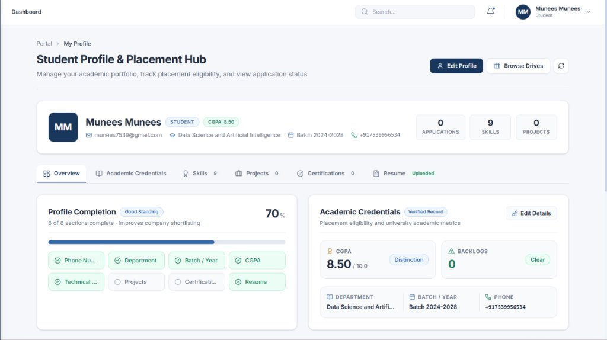

# Student Placement Management System

> A full-stack **Enterprise University Placement Portal** built with the **MERN** stack (MongoDB, Express.js, React.js, Node.js). Designed for universities to manage campus recruitment drives, student applications, company partnerships, and placement officer operations — all from a single professional portal.

---

## 📸 Screenshots

### Student Profile & Placement Hub



---

## 🛠️ Technology Stack

### Frontend
| Technology | Version | Purpose |
|---|---|---|
| **React.js** | 18+ | UI framework (Vite scaffold) |
| **Tailwind CSS** | 3.x | Utility-first responsive styling |
| **Lucide React** | Latest | Consistent professional iconography |
| **Axios** | Latest | HTTP client with JWT interceptors |
| **React Router** | v7 | Client-side navigation & routing |
| **Inter** | Google Fonts | Professional typography |

### Backend
| Technology | Version | Purpose |
|---|---|---|
| **Node.js** | v18+ | Server runtime |
| **Express.js** | 4.x | REST API framework (ES Modules) |
| **MongoDB** | 6.x | Primary NoSQL database |
| **Mongoose** | 8.x | ODM with schema validation |
| **JSON Web Token** | Latest | Stateless authentication |
| **bcryptjs** | Latest | Secure password hashing |

---

## 📁 Project Structure

```
placement-management-system/
│
├── screenshots/                          # UI screenshots for documentation
│   ├── student-profile.jpg
│   └── companies-page.png
│
├── backend/
│   ├── src/
│   │   ├── config/
│   │   │   └── db.js                        # MongoDB connection (Mongoose)
│   │   ├── controllers/
│   │   │   ├── authController.js            # Register, login, profile
│   │   │   ├── companyController.js         # CRUD for partner companies
│   │   │   ├── placementDriveController.js  # Placement drive lifecycle
│   │   │   ├── applicationController.js     # Student application management
│   │   │   └── studentProfileController.js  # Student profile & academic data
│   │   ├── middlewares/
│   │   │   ├── authMiddleware.js            # JWT verification & RBAC guards
│   │   │   ├── errorMiddleware.js           # Centralized error handling
│   │   │   ├── companyValidation.js         # Company field validation
│   │   │   ├── placementDriveValidation.js  # Drive validation rules
│   │   │   ├── applicationValidation.js     # Application validation
│   │   │   └── uploadMiddleware.js          # File upload handling
│   │   ├── models/
│   │   │   ├── User.js                      # User schema (bcrypt, roles)
│   │   │   ├── StudentProfile.js            # Academic & placement profile
│   │   │   ├── Company.js                   # Partner company schema
│   │   │   ├── PlacementDrive.js            # Recruitment drive schema
│   │   │   └── Application.js              # Student application schema
│   │   ├── routes/
│   │   │   ├── authRoutes.js                # /api/auth
│   │   │   ├── companyRoutes.js             # /api/companies
│   │   │   ├── placementDriveRoutes.js      # /api/drives
│   │   │   ├── applicationRoutes.js         # /api/applications
│   │   │   └── studentProfileRoutes.js      # /api/student-profile
│   │   ├── utils/
│   │   │   └── eligibilityEngine.js         # CGPA/backlog eligibility logic
│   │   ├── app.js                           # Express app setup & middleware
│   │   └── server.js                        # HTTP server bootstrap
│   ├── .env
│   ├── .env.example
│   └── package.json
│
├── frontend/
│   ├── public/
│   │   └── student-portal-art.jpg
│   ├── src/
│   │   ├── api/
│   │   │   ├── axios.js                     # Axios instance with Bearer token
│   │   │   ├── companyApi.js                # Company API calls
│   │   │   ├── placementDriveApi.js         # Drive API calls
│   │   │   ├── applicationApi.js            # Application API calls
│   │   │   └── studentProfileApi.js         # Profile API calls
│   │   ├── components/
│   │   │   ├── common/
│   │   │   │   ├── Sidebar.jsx              # Fixed enterprise sidebar nav
│   │   │   │   ├── Topbar.jsx               # Top bar with breadcrumb & search
│   │   │   │   ├── Navbar.jsx               # Public page navigation
│   │   │   │   ├── PageHeader.jsx           # Reusable page title + actions
│   │   │   │   ├── StatusBadge.jsx          # Colored status indicator chips
│   │   │   │   └── ProtectedRoute.jsx       # Auth & role-based route guard
│   │   │   ├── companies/
│   │   │   │   ├── CompanyCard.jsx          # Grid card for company
│   │   │   │   ├── CompanyTableView.jsx     # Table view for companies
│   │   │   │   ├── CompanyModal.jsx         # Create/Edit company form modal
│   │   │   │   ├── CompanyDetailModal.jsx   # Full detail inspection modal
│   │   │   │   ├── CompanyFilterBar.jsx     # Search & industry filter bar
│   │   │   │   └── DeleteConfirmModal.jsx   # Deletion confirmation dialog
│   │   │   ├── drives/
│   │   │   │   ├── DriveCard.jsx            # Grid card for placement drive
│   │   │   │   ├── DriveTableView.jsx       # Table view for drives
│   │   │   │   ├── DriveModal.jsx           # Create/Edit drive form modal
│   │   │   │   ├── DriveDetailModal.jsx     # Full drive detail view
│   │   │   │   ├── DriveFilterBar.jsx       # Drive filter controls
│   │   │   │   └── DeleteDriveModal.jsx     # Drive deletion confirmation
│   │   │   ├── applications/
│   │   │   │   ├── ApplicantActionModal.jsx # Officer update status modal
│   │   │   │   ├── ApplicationStatusBadge.jsx # Application status chip
│   │   │   │   ├── ApplicationTimeline.jsx  # Status history timeline
│   │   │   │   └── ApplyConfirmModal.jsx    # Student apply confirmation
│   │   │   └── student/
│   │   │       ├── AcademicStatsCard.jsx    # CGPA, backlogs, dept card
│   │   │       ├── ProfileCompletionCard.jsx # Completion progress card
│   │   │       ├── SkillsManager.jsx        # Add/remove technical skills
│   │   │       ├── ProjectsSection.jsx      # Student projects list
│   │   │       ├── CertificationsSection.jsx # Certifications list
│   │   │       ├── ResumeSection.jsx        # Resume upload/view section
│   │   │       ├── EditProfileModal.jsx     # Edit personal details modal
│   │   │       ├── ProjectModal.jsx         # Add/Edit project modal
│   │   │       ├── CertificationModal.jsx   # Add/Edit certification modal
│   │   │       └── ResumeModal.jsx          # Resume PDF upload modal
│   │   ├── context/
│   │   │   └── AuthContext.jsx              # Global auth state & token mgmt
│   │   ├── pages/
│   │   │   ├── Home.jsx                     # Public landing page
│   │   │   ├── Login.jsx                    # Sign-in page
│   │   │   ├── Register.jsx                 # Registration with role selection
│   │   │   ├── Dashboard.jsx                # Role-aware dashboard hub
│   │   │   ├── Companies.jsx                # Company directory page
│   │   │   ├── PlacementDrives.jsx          # Placement drives page
│   │   │   └── Applications.jsx             # Applications management page
│   │   ├── routes/
│   │   │   └── AppRoutes.jsx                # Centralized route definitions
│   │   ├── App.jsx                          # Root layout & context providers
│   │   ├── index.css                        # Tailwind directives & base styles
│   │   └── main.jsx                         # React DOM mount
│   ├── index.html
│   ├── vite.config.js
│   └── package.json
│
└── README.md
```

---

## 🚀 Getting Started

The frontend and backend are fully decoupled and run in separate terminals.

### Prerequisites
- **Node.js** v18 or higher (tested on v24)
- **MongoDB** — local (`mongodb://127.0.0.1:27017`) or MongoDB Atlas URI

---

### 1. Backend Setup

```bash
cd backend
npm install
```

Create or verify `backend/.env`:
```env
PORT=5000
NODE_ENV=development
MONGO_URI=mongodb://127.0.0.1:27017/placement_management_db
JWT_SECRET=supersecretjwtkey_change_in_production
JWT_EXPIRES_IN=7d
CLIENT_URL=http://localhost:5173
```

Run the backend:
```bash
# Development (auto-restart)
npm run dev

# Production
npm start
```

> API available at `http://localhost:5000`  
> Health check: `http://localhost:5000/api/health`

---

### 2. Frontend Setup

```bash
cd frontend
npm install
```

Verify `frontend/.env`:
```env
VITE_API_BASE_URL=http://localhost:5000/api
```

Run the frontend:
```bash
# Development server
npm run dev

# Production build
npm run build

# Preview production build
npm run preview
```

> App available at `http://localhost:5173`

---

## 👥 User Roles

| Role | Access Level | Description |
|---|---|---|
| `STUDENT` | Read + Self-manage | Browse companies & drives, apply, manage own profile |
| `PLACEMENT_OFFICER` | Full operational | Manage companies, drives, review applications |
| `ADMIN` | Full system | All officer permissions + user management |

---

## 🔐 API Reference

### Authentication

| Method | Endpoint | Description | Access |
|---|---|---|---|
| `GET` | `/api/health` | Service health check | Public |
| `POST` | `/api/auth/register` | Register new user | Public |
| `POST` | `/api/auth/login` | Login & receive JWT | Public |
| `GET` | `/api/auth/me` | Get current user profile | 🔒 Protected |
| `POST` | `/api/auth/change-password` | Update password (first login / voluntary) | 🔒 Protected |

### Admin Operations

| Method | Endpoint | Description | Access |
|---|---|---|---|
| `GET` | `/api/admin/students` | List all registered students | 🔒 Admin Only |
| `POST` | `/api/admin/students` | Register single student account | 🔒 Admin Only |
| `POST` | `/api/admin/students/bulk-import` | Bulk import students via CSV/Excel | 🔒 Admin Only |
| `POST` | `/api/admin/students/:id/resend-credentials` | Regenerate & email temporary credentials | 🔒 Admin Only |

### Companies

| Method | Endpoint | Description | Access |
|---|---|---|---|
| `GET` | `/api/companies` | List all companies | 🔒 All roles |
| `GET` | `/api/companies/:id` | Get company details | 🔒 All roles |
| `POST` | `/api/companies` | Create new company | 🔒 Officer / Admin |
| `PUT` | `/api/companies/:id` | Update company | 🔒 Officer / Admin |
| `DELETE` | `/api/companies/:id` | Delete company | 🔒 Officer / Admin |

### Placement Drives

| Method | Endpoint | Description | Access |
|---|---|---|---|
| `GET` | `/api/drives` | List all drives | 🔒 All roles |
| `GET` | `/api/drives/:id` | Get drive details | 🔒 All roles |
| `POST` | `/api/drives` | Create placement drive | 🔒 Officer / Admin |
| `PUT` | `/api/drives/:id` | Update drive | 🔒 Officer / Admin |
| `DELETE` | `/api/drives/:id` | Delete drive | 🔒 Officer / Admin |

### Applications

| Method | Endpoint | Description | Access |
|---|---|---|---|
| `GET` | `/api/applications` | List applications | 🔒 Role-filtered |
| `POST` | `/api/applications` | Submit application | 🔒 Student |
| `PUT` | `/api/applications/:id` | Update status / remarks | 🔒 Officer / Admin |
| `DELETE` | `/api/applications/:id` | Withdraw application | 🔒 Student (own only) |

### Student Profile

| Method | Endpoint | Description | Access |
|---|---|---|---|
| `GET` | `/api/student-profile/me` | Get own profile | 🔒 Student |
| `PUT` | `/api/student-profile/me` | Update profile | 🔒 Student |
| `POST` | `/api/student-profile/me/skills` | Add skill | 🔒 Student |
| `DELETE` | `/api/student-profile/me/skills/:skill` | Remove skill | 🔒 Student |
| `POST` | `/api/student-profile/me/projects` | Add project | 🔒 Student |
| `PUT` | `/api/student-profile/me/projects/:id` | Edit project | 🔒 Student |
| `DELETE` | `/api/student-profile/me/projects/:id` | Delete project | 🔒 Student |
| `POST` | `/api/student-profile/me/certifications` | Add certification | 🔒 Student |
| `PUT` | `/api/student-profile/me/certifications/:id` | Edit certification | 🔒 Student |
| `DELETE` | `/api/student-profile/me/certifications/:id` | Delete certification | 🔒 Student |

---

## 🏢 Module Overview

### 🎓 Student Dashboard & Profile Hub (`/dashboard`)
- Role-aware dashboard with KPI stats, recent applications, and upcoming drives.
- Student profile tabs: **Overview · Academic Credentials · Skills · Projects · Certifications · Resume**
- **Profile Completion** tracker showing 8-point checklist.
- **Academic Stats Card** — CGPA, backlog count, department, batch, phone.
- **Skills Manager** — add/remove technical skills with tag chips.
- **Projects Section** — card-per-project layout with tech stack and links.
- **Certifications Section** — certificate name, issuer, year, credential link.
- **Resume Section** — PDF upload with file preview.

### 🏢 Company Directory (`/companies`)
- Browse all campus recruitment partner organizations.
- **Dual layout**: Interactive grid cards + data-dense table view.
- Live search by name, industry, location, or keywords.
- Industry category filter dropdown.
- **Officer / Admin**: Add, Edit, Delete companies.
- **Student**: Read-only with recruiter contact details and website links.

### 📋 Placement Drives (`/drives`)
- Browse, filter, and apply for active campus placement drives.
- Filter by company, job role, status, eligibility criteria.
- **Drive cards** show company, role, package, eligibility, deadline.
- **Student**: One-click apply with remarks; tracks already-applied status.
- **Officer / Admin**: Create, edit, delete drives; manage drive lifecycle.
- Eligibility engine checks CGPA and backlog requirements before allowing applications.

### 📂 Applications (`/applications`)
- **Student view**: Track all submitted applications with status and timeline.
- **Officer / Admin view**: Review all applications, filter by drive/status/student.
- Status management: `PENDING → SHORTLISTED → INTERVIEW → SELECTED / REJECTED`.
- Application status timeline with remarks history.
- Withdraw option for pending applications (students).

### 🧑‍💼 Officer Command Center (`/officer-portal`)
- Full operational dashboard for Placement Officers.
- Overview of active drives, total applications, company partnerships.
- Quick actions to manage drives and review applicant pipelines.

### ⚙️ Admin Portal & Student Management (`/admin-portal`, `/admin/add-student`, `/admin/bulk-import`)
- **Registered Students Directory**: Centralized table on the Admin Dashboard listing all registered student accounts with live search and filtering.
- **Single Student Registration (`/admin/add-student`)**: Form to register individual students with validation against duplicate emails and register numbers.
- **Bulk Student Import (`/admin/bulk-import`)**:
  - Drag-and-drop file upload supporting `.xlsx`, `.xls`, and `.csv`.
  - Downloadable Excel and CSV sample templates.
  - Client-side pre-import validation and live preview with Valid / Invalid filters.
  - Automatic cryptographically secure temporary password generation (10-character high-entropy strings).
  - Passwords hashed with `bcryptjs` before storage; plaintext passwords are never saved.
  - Automatic dispatch of branded onboarding emails with login credentials via Nodemailer (or dev simulation).
  - Metric KPI tiles tracking processed rows, created accounts, dispatched emails, and failed records.
  - Resend Credentials action allowing administrators to regenerate and re-email temporary credentials safely.
- **First-Time Password Change (`/change-password`)**:
  - Enforced via `mustChangePassword` flag on the user model.
  - Redirects students directly on first sign-in before allowing access to the placement hub or drives.
  - Password strength validation (6+ characters, uppercase, number/special symbol).

---

## 🎨 Design System

| Token | Value | Usage |
|---|---|---|
| Primary | `#19365C` | Buttons, sidebar, headings |
| Secondary | `#3569A8` | Links, accents, highlights |
| Background | `#F5F7FA` | App background |
| Surface | `#FFFFFF` | Cards, modals, panels |
| Text Primary | `#202B3C` | Body text, headings |
| Text Secondary | `#667085` | Subtitles, labels, placeholders |
| Border | `#E4E8EF` | Dividers, card borders |
| Success | `#16845B` | Selected, active, approved |
| Warning | `#C58A25` | Pending, in-progress states |
| Danger | `#D14343` | Rejected, delete, errors |

**Font:** Inter (Google Fonts)  
**Icons:** Lucide React — consistent 18–22px, strokeWidth 1.8  

---

## 🔒 Security

- JWT tokens stored in `localStorage` and injected via Axios interceptor.
- All protected routes verified with `authMiddleware` on every request.
- Role-based access enforced at both API (middleware) and UI (component) levels.
- Passwords hashed with `bcryptjs` using salted rounds before storage.
- CORS configured to allow only the frontend origin.

---

## 📦 Build & Deployment

```bash
# Build frontend for production
npm run build --prefix frontend

# Output: frontend/dist/
```

For deployment, serve the `frontend/dist/` folder via a static host (Netlify, Vercel, Nginx) and deploy the backend to any Node.js platform (Render, Railway, EC2).

---

## 📄 License

MIT License — Free to use and modify for academic and educational purposes.
